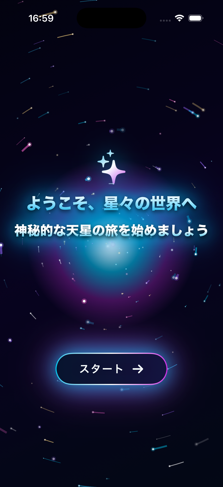

# 日専祭アプリ：天星

> **チーム：** チーム名:Nerv, 氏名:26CMシャィン　コ　コ　アウン
> メンバー名:26CM0106カウン ミャット トゥー、26CM0127ハン トゥン ゾー
> **AI利用レベル：** 2（生成コード可）
> **最終更新：** 2026-10-05

> 💡 制作の進め方は担任の先生から案内があります。このファイルの項目は、担任の先生の指示で増えることがあります。

---

## 何ができるアプリか（3行）

>このアプリは、星について詳しく知ることができるアプリです。

>星の名前や特徴、明るさなどの情報を分かりやすく紹介します。

>また、星の画像を見ることもでき、楽しみながら星について学ぶことができます。

## 画面

 

## 使った文法・技術

構造体(struct): SkyStar、Constellation、ZodiacSign などのデータと画面
列挙型(enum): AppLanguage(en / ja / my)
クラス(class): JourneyStore、Camera、SkyMusic
拡張(extension): Color(hex:) で16進数の色を使えるようにした
配列: append(occupiedLabels.append、order.append)と remove(at:)(orderedStars.remove(at:))
集合(Set): お気に入りの保存。insert と remove で追加・削除
辞書(Dictionary): 星座の線のデータ(figures)や多言語の文章(strings)
オプショナル: ?、??、if let、guard let
switch 文: 誕生日から星座を判定(case 321...419:)
クロージャ: map、filter、first(where:)、contains(where:)
async / await: 音楽のフェードアウト後に一時停止する処理

## 生成AIの使い方（どの場面で、どう使ったか）
アプリの80割はAIを使いました。星の情報、神話、星空を作り方法、色々なことをAIを聞いて作りました。BGMまでAIに任せました。

## 展示で工夫した点
アプリのナビゲーションはもっとシンプルにした方がいいかな。時間がなくてアプリはまだ完璧ではないです。色々入れたいこともあります。
